 

<strong>DESIGN · CODE · COSMIC CURIOSITY</strong>

<a href="https://github.com/jk-larbi?tab=repositories">PORTFOLIO / REPOSITORIES</a>
&nbsp;&nbsp;·&nbsp;&nbsp;
<a href="https://github.com/jk-larbi?tab=stars">STARRED WORK</a>
&nbsp;&nbsp;·&nbsp;&nbsp;
<a href="https://github.com/jk-larbi">GITHUB PROFILE</a>

---

<table>
<tr>
<td width="62%" valign="top">

## 01 / The person behind the commits

I'm Joshua — a Computer Science student at the **University of Cape Coast, Ghana**.

I work across the creative and technical sides of building digital products. I care about how a product looks, how naturally it works, and whether it genuinely solves the problem it was made for.

My sweet spot is **user experience + interface design + front-end development**. I'm also steadily building my knowledge of cybersecurity, networking and Linux.

</td>
<td width="38%" valign="top">

## Quick facts

**EDUCATION**  
Computer Science · UCC

**DESIGN**  
UI/UX · Figma · Graphics

**DEVELOPMENT**  
Web · Mobile · Java

**TEAM ROLE**  
UI Lead · ScheDORA

**EXPLORING**  
Cybersecurity · Networking

**LOCATION**  
Ghana

</td>
</tr>
</table>

## 02 / Tools on my desk

| FOCUS | TOOLS & SKILLS |
|:--|:--|
| **Design** | Figma · Photoshop · Illustrator · UI/UX · Prototyping |
| **Development** | HTML · CSS · JavaScript · TypeScript · React · Java · Flutter |
| **Workflow** | Git · GitHub · VS Code · Linux |
| **Growing in** | Cybersecurity · Networking · Systems |

---

## 03 / Selected work

PROJECTS I OWN OR MAINTAIN

<table>
<tr>
<td width="50%" valign="top">

**01 — <a href="https://github.com/jk-larbi/Bible-Arena-2.0">BIBLE ARENA 2.0</a>**

A scripture-based gaming platform focused on interactive learning, challenges, levels and multiplayer experiences.

INTERACTIVE LEARNING · PRODUCT BUILD

</td>
<td width="50%" valign="top">

**02 — <a href="https://github.com/jk-larbi/bible-arena">BIBLE ARENA</a>**

An interactive Bible learning project exploring scripture activities and multiplayer game concepts.

EDUCATION · GAME CONCEPTS

</td>
</tr>
<tr>
<td width="50%" valign="top">

**03 — <a href="https://github.com/jk-larbi/FNI-APP-2.0">FNI APP 2.0</a>**

A mobile-first ministry and community app concept for connecting members and supporting ministry activities.

MOBILE EXPERIENCE · COMMUNITY

</td>
<td width="50%" valign="top">

**04 — <a href="https://github.com/jk-larbi/FNI-Cells-Connect">FNI CELLS CONNECT</a>**

A reporting and coordination portal for cell leaders, tutors and administrators.

PORTAL · WORKFLOW DESIGN

</td>
</tr>
<tr>
<td width="50%" valign="top">

**05 — <a href="https://github.com/jk-larbi/FNI-web-prototype">FNI WEB PROTOTYPE</a>**

An early web experience exploring the FNI project's digital presence and interface direction.

WEB DESIGN · PROTOTYPING

</td>
<td width="50%" valign="top">

**06 — <a href="https://github.com/jk-larbi/benedicta-portfolio">BENEDICTA PORTFOLIO</a>**

A portfolio website project focused on presenting work and personal identity through a clean web experience.

PORTFOLIO · WEB EXPERIENCE

</td>
</tr>
</table>

## 04 / Work with others

COLLABORATIONS & SPECIFIC CONTRIBUTIONS — NOT REPOSITORY OWNERSHIP

| PROJECT | MY PART |
|:--|:--|
| [ScheDORA](https://github.com/natt-pb/ScheDORA) | **UI Lead / UI Designer** — led UI work and contributed to the visual identity and JavaFX interface across dashboard, login, navigation, timetable, booking and administration screens. |
| [Cosmic Frontier](https://github.com/NeonTechno/Cosmic-Frontier) | **UI / Front-end contributor** — mission-control interface refinement, typography and branding updates, browser icon cleanup and SPHEREx editorial hero. [Merged contributions ↗](https://github.com/NeonTechno/Cosmic-Frontier/pulls?q=is%3Apr+author%3Ajk-larbi) |
| [Compiler Group 22](https://github.com/Dandyloo/COMPILER_GROUP_TWENTY_TWO) | **Parser contribution** — contributed to the arithmetic expression parser. [Merged PR #23 ↗](https://github.com/Dandyloo/COMPILER_GROUP_TWENTY_TWO/pull/23) |

---

## 05 / Activity log

I prefer keeping this section reliable rather than depending on third-party statistic image services that may fail to load.

- [View my contribution activity](https://github.com/jk-larbi?tab=overview)
- [Explore my repositories](https://github.com/jk-larbi?tab=repositories)
- [See my contribution history](https://github.com/jk-larbi?tab=overview#contributions-calendar)

## 06 / The direction

I'm working towards becoming a versatile technology professional — someone who can understand a challenge, design a thoughtful solution and build software people enjoy using.

The long-term interest is where **design, engineering and security** meet.

## 07 / Beyond the screen — astronomy

I'm fascinated by astronomy: the scale of the universe, distant worlds, stars and the science behind what we observe. I enjoy exploring space missions and discoveries alongside my technology interests.

ORBITAL MOTION · EXOPLANET CURIOSITY · DEEP SPACE

Thanks for visiting. Keep looking up.

