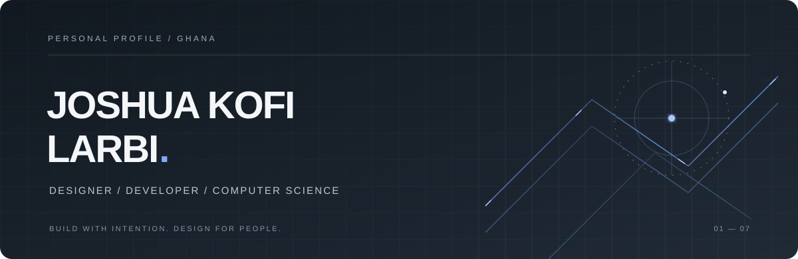
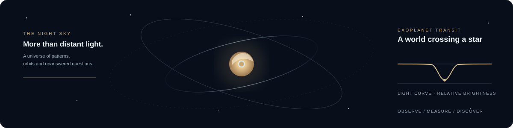

<a href="https://github.com/jk-larbi?tab=repositories">PROJECTS</a>
&nbsp;&nbsp; / &nbsp;&nbsp;
<a href="https://github.com/jk-larbi?tab=overview">ACTIVITY</a>
&nbsp;&nbsp; / &nbsp;&nbsp;
<a href="https://github.com/jk-larbi?tab=stars">BOOKMARKS</a>

---

## 01 — A little about me

I'm Joshua, a Computer Science student at the **University of Cape Coast, Ghana**.

I enjoy working where **interface design and software development** meet: understanding a problem, shaping a clear experience, and turning that experience into something useful. My current focus is UI/UX, front-end development and building stronger engineering foundations.

Away from the screen, I'm drawn to astronomy — especially exoplanets, orbital mechanics and the science behind observing distant worlds.

---

## 02 — Tools & technologies

**DESIGN & CREATIVE**

 

**DEVELOPMENT**

 

**TOOLS & SYSTEMS**

| AREA | TOOLS & PRACTICE |
|:--|:--|
| **Product & interface design** | Figma · UI/UX · Wireframing · Prototyping |
| **Graphic design** | Adobe Photoshop · Adobe Illustrator |
| **Web development** | HTML · CSS · JavaScript · TypeScript · React |
| **Programming & mobile** | Java · Flutter |
| **Tools & systems** | Git · GitHub · VS Code · Linux |
| **Currently strengthening** | Cybersecurity · Networking · Systems fundamentals |

---

## 03 — Selected projects

PROJECTS I OWN OR MAINTAIN

| PROJECT | WHAT IT IS |
|:--|:--|
| **[BIBLE ARENA 2.0](https://github.com/jk-larbi/Bible-Arena-2.0)** | A scripture-based gaming platform exploring interactive learning, challenges, progression and multiplayer experiences. |
| **[BIBLE ARENA](https://github.com/jk-larbi/bible-arena)** | An earlier Bible learning project built around scripture activities and game concepts. |
| **[FNI APP 2.0](https://github.com/jk-larbi/FNI-APP-2.0)** | A mobile-first ministry and community app concept for connecting members and supporting ministry activities. |
| **[FNI CELLS CONNECT](https://github.com/jk-larbi/FNI-Cells-Connect)** | A reporting and coordination portal for cell leaders, tutors and administrators. |
| **[FNI WEB PROTOTYPE](https://github.com/jk-larbi/FNI-web-prototype)** | An early web experience exploring the FNI project's digital presence and interface direction. |
| **[BENEDICTA PORTFOLIO](https://github.com/jk-larbi/benedicta-portfolio)** | A portfolio website focused on presenting work and personal identity through a clean web experience. |
| **[CHRISTIAN BOOKS UI DESIGN](https://github.com/jk-larbi/ui-design-of-a-Christian-online-book-store)** | A Christian online bookstore interface designed in Adobe XD, with a static UI concept and visual preview. |
| **[STUDENT HOSPITAL APP — CAREPULSE](https://github.com/jk-larbi/Student-hospital-app)** | A student-focused health companion for appointments, medical records, medication schedules, emergency SOS and wellness checks. |

---

## 04 — Collaborations

CONTRIBUTIONS & TEAM ROLES — THESE ARE NOT PROJECT OWNERSHIPS

**[ScheDORA](https://github.com/natt-pb/ScheDORA)**  
**UI Lead / UI Designer** — led UI work and contributed to the visual identity and JavaFX interface, including dashboard, login, navigation, timetable, booking and administration screens.

**[Cosmic Frontier](https://github.com/NeonTechno/Cosmic-Frontier)**  
**UI / Front-end contributor** — contributed to mission-control interface refinement, typography, branding, browser icon cleanup and the SPHEREx editorial hero. [View my pull requests](https://github.com/NeonTechno/Cosmic-Frontier/pulls?q=is%3Apr+author%3Ajk-larbi).

**[Compiler Group 22](https://github.com/Dandyloo/COMPILER_GROUP_TWENTY_TWO)**  
**Parser contributor** — contributed to the arithmetic expression parser. [Merged PR #23](https://github.com/Dandyloo/COMPILER_GROUP_TWENTY_TWO/pull/23).

---

## 05 — The working philosophy

I value interfaces that feel considered, software that solves a real need, and collaboration that makes the final product stronger.

I'm growing towards becoming a versatile technology professional — someone who can move from understanding a challenge, to designing a thoughtful solution, to building and refining it.

---

## 06 — Beyond the screen

**ASTRONOMY / OBSERVATIONAL SCIENCE**

Exoplanets, stellar systems, orbital motion and space-mission data are some of the subjects I keep coming back to. I enjoy the process of turning distant signals into meaningful scientific insight — and the curiosity that drives it.

LOOK CLOSER. ASK BETTER QUESTIONS. KEEP EXPLORING.

---

<a href="https://github.com/jk-larbi?tab=repositories">EXPLORE MY REPOSITORIES</a>
&nbsp;&nbsp;·&nbsp;&nbsp;
<a href="https://github.com/jk-larbi?tab=overview">VIEW GITHUB ACTIVITY</a>

THANKS FOR STOPPING BY.

